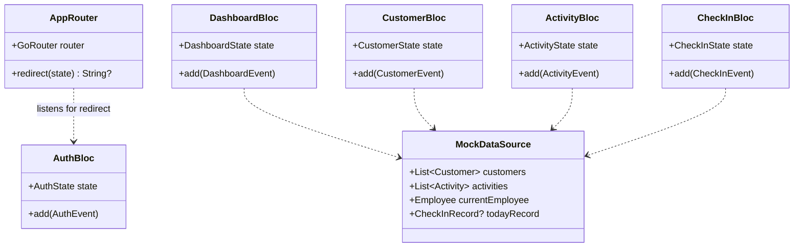

# Design Document

## Overview

MobileTestAI is a Flutter POC that demonstrates Kiro IDE's AI-assisted development workflow. The application implements six features — authentication, employee dashboard, check-in/check-out, customer management, follow-up activity management, and cross-cutting validation — using Clean Architecture, BLoC state management, and an in-memory mock data layer. No backend, database, or network calls are used anywhere in the application.

The design serves two purposes simultaneously: it delivers a working employee field-management app and it showcases Kiro tooling (steering files, custom agents, agent hooks) as a development-workflow artefact.

### Key Constraints

- All data lives in memory only; no persistence across app restarts.
- Exactly one `MockDataSource` singleton provides all demo data for every feature.
- Domain layer is pure Dart — zero Flutter imports.
- Every BLoC uses `equatable` for state equality, enabling `bloc_test` assertions.
- Routing is managed entirely by `go_router` from a single configuration file.

---

## Architecture

### Layered Architecture

The application follows Clean Architecture with three named layers per feature, plus a shared `core/` area for cross-cutting concerns.

```mermaid
flowchart TD
    subgraph Presentation["Presentation Layer (flutter_bloc, Widgets)"]
        UI[Screens / Widgets]
        BLOCS[BLoCs: AuthBloc · DashboardBloc · CheckInBloc · CustomerBloc · ActivityBloc]
        EVENTS[Events]
        STATES[States]
        UI -->|dispatch| EVENTS
        EVENTS --> BLOCS
        BLOCS -->|emit| STATES
        STATES --> UI
    end

    subgraph Domain["Domain Layer (pure Dart)"]
        ENTITIES[Entities: Employee · Customer · Activity]
        REPOS_I[Repository Interfaces]
        USECASES[UseCases: single call() method each]
    end

    subgraph Data["Data Layer"]
        MDS[MockDataSource singleton]
        REPOS_IMPL[Repository Implementations]
        MDS --> REPOS_IMPL
    end

    subgraph Core["Core"]
        ROUTER[go_router AppRouter]
        DI[DI / ServiceLocator]
        VALIDATION[Validators]
    end

    BLOCS -->|call UseCases| USECASES
    USECASES -->|call interfaces| REPOS_I
    REPOS_I -.->|implemented by| REPOS_IMPL
    REPOS_IMPL -->|reads/writes| MDS
    DI -->|provides BLoCs| Presentation
    ROUTER -->|auth redirect| BLOCS
```

### Dependency Rule

```
Presentation  →  Domain  ←  Data
                Core (router, DI, validation) crosses layers only via interfaces
```

The domain layer has zero outward dependencies. Data and presentation both depend on domain. Core utilities may be imported by presentation but never by domain.

### Component Relationships



---

## Components and Interfaces

### Folder Structure

```
lib/
├── core/
│   ├── di/
│   │   └── service_locator.dart          # get_it / manual DI setup
│   ├── router/
│   │   └── app_router.dart               # GoRouter definition + auth guard
│   └── validation/
│       ├── email_validator.dart
│       ├── password_validator.dart
│       └── activity_validator.dart
│
├── features/
│   ├── auth/
│   │   ├── domain/
│   │   │   ├── entities/employee.dart
│   │   │   ├── repositories/auth_repository.dart
│   │   │   └── usecases/login_usecase.dart
│   │   ├── data/
│   │   │   └── repositories/auth_repository_impl.dart
│   │   └── presentation/
│   │       ├── bloc/
│   │       │   ├── auth_bloc.dart
│   │       │   ├── auth_event.dart
│   │       │   └── auth_state.dart
│   │       └── screens/
│   │           └── login_screen.dart
│   │
│   ├── dashboard/
│   │   ├── domain/
│   │   │   ├── entities/dashboard_summary.dart
│   │   │   ├── repositories/dashboard_repository.dart
│   │   │   └── usecases/get_dashboard_summary_usecase.dart
│   │   ├── data/
│   │   │   └── repositories/dashboard_repository_impl.dart
│   │   └── presentation/
│   │       ├── bloc/
│   │       │   ├── dashboard_bloc.dart
│   │       │   ├── dashboard_event.dart
│   │       │   └── dashboard_state.dart
│   │       └── screens/
│   │           └── dashboard_screen.dart
│   │
│   ├── check_in/
│   │   ├── domain/
│   │   │   ├── entities/check_in_record.dart
│   │   │   ├── repositories/check_in_repository.dart
│   │   │   ├── usecases/check_in_usecase.dart
│   │   │   └── usecases/check_out_usecase.dart
│   │   ├── data/
│   │   │   └── repositories/check_in_repository_impl.dart
│   │   └── presentation/
│   │       ├── bloc/
│   │       │   ├── check_in_bloc.dart
│   │       │   ├── check_in_event.dart
│   │       │   └── check_in_state.dart
│   │       └── screens/
│   │           └── check_in_screen.dart
│   │
│   ├── customer/
│   │   ├── domain/
│   │   │   ├── entities/customer.dart
│   │   │   ├── repositories/customer_repository.dart
│   │   │   ├── usecases/get_customers_usecase.dart
│   │   │   └── usecases/get_customer_by_id_usecase.dart
│   │   ├── data/
│   │   │   └── repositories/customer_repository_impl.dart
│   │   └── presentation/
│   │       ├── bloc/
│   │       │   ├── customer_bloc.dart
│   │       │   ├── customer_event.dart
│   │       │   └── customer_state.dart
│   │       └── screens/
│   │           ├── customer_list_screen.dart
│   │           └── customer_detail_screen.dart
│   │
│   ├── activity/
│   │   ├── domain/
│   │   │   ├── entities/activity.dart
│   │   │   ├── repositories/activity_repository.dart
│   │   │   ├── usecases/get_activities_usecase.dart
│   │   │   ├── usecases/add_activity_usecase.dart
│   │   │   └── usecases/mark_activity_done_usecase.dart
│   │   ├── data/
│   │   │   └── repositories/activity_repository_impl.dart
│   │   └── presentation/
│   │       ├── bloc/
│   │       │   ├── activity_bloc.dart
│   │       │   ├── activity_event.dart
│   │       │   └── activity_state.dart
│   │       └── screens/
│   │           ├── activity_list_screen.dart
│   │           └── add_activity_screen.dart
│   │
│   └── mock_data/
│       └── mock_data_source.dart         # single shared in-memory source
│
└── main.dart

test/
├── features/
│   ├── auth/
│   │   ├── domain/usecases/login_usecase_test.dart
│   │   └── presentation/bloc/auth_bloc_test.dart
│   ├── dashboard/
│   │   ├── domain/usecases/get_dashboard_summary_usecase_test.dart
│   │   └── presentation/bloc/dashboard_bloc_test.dart
│   ├── check_in/
│   │   ├── domain/usecases/check_in_usecase_test.dart
│   │   ├── domain/usecases/check_out_usecase_test.dart
│   │   └── presentation/bloc/check_in_bloc_test.dart
│   ├── customer/
│   │   ├── domain/usecases/get_customers_usecase_test.dart
│   │   └── presentation/bloc/customer_bloc_test.dart
│   ├── activity/
│   │   ├── domain/usecases/add_activity_usecase_test.dart
│   │   ├── domain/usecases/mark_activity_done_usecase_test.dart
│   │   └── presentation/bloc/activity_bloc_test.dart
│   └── mock_data/mock_data_source_test.dart
├── widget/
│   ├── login_screen_test.dart
│   ├── dashboard_screen_test.dart
│   └── customer_list_screen_test.dart
└── integration_test/
    └── happy_path_test.dart
```

### Core Validators Interface

```dart
// lib/core/validation/email_validator.dart
abstract class EmailValidator {
  static String? validate(String? value);
  // Returns null if valid; error message string if invalid.
  // Rule: non-empty, matches local@domain.tld,
  //       local-part 1–64 chars, domain 1–255 chars.
}

// lib/core/validation/password_validator.dart
abstract class PasswordValidator {
  static String? validate(String? value);
  // Returns null if valid; error message string if invalid.
  // Rule: 6–128 characters, non-empty.
}

// lib/core/validation/activity_validator.dart
abstract class ActivityValidator {
  static String? validateTitle(String? value);
  // Rule: non-empty, at most 200 characters.
  static String? validateDueDate(DateTime? value);
  // Rule: not null, not before current calendar date.
  static String? validateCustomer(String? customerId);
  // Rule: not null, not empty string.
}
```

---

## Data Models

### Domain Entities

All entities extend `Equatable` and are immutable. Zero Flutter imports.

```dart
// lib/features/auth/domain/entities/employee.dart
class Employee extends Equatable {
  final String id;
  final String name;
  final String email;

  const Employee({required this.id, required this.name, required this.email});

  @override
  List<Object?> get props => [id, name, email];
}

// lib/features/customer/domain/entities/customer.dart
class Customer extends Equatable {
  final String id;
  final String fullName;
  final String companyName;
  final String? email;         // nullable — optional field
  final String? phoneNumber;   // nullable — optional field
  final String? notes;         // nullable — optional field

  const Customer({
    required this.id,
    required this.fullName,
    required this.companyName,
    this.email,
    this.phoneNumber,
    this.notes,
  });

  @override
  List<Object?> get props =>
      [id, fullName, companyName, email, phoneNumber, notes];
}

// lib/features/activity/domain/entities/activity.dart
enum ActivityStatus { pending, done }

class Activity extends Equatable {
  final String id;
  final String customerId;
  final String customerName;   // denormalised for display
  final String title;          // max 100 chars display; 200 chars allowed in model
  final DateTime dueDate;
  final ActivityStatus status;

  const Activity({
    required this.id,
    required this.customerId,
    required this.customerName,
    required this.title,
    required this.dueDate,
    required this.status,
  });

  Activity copyWith({ActivityStatus? status}) => Activity(
        id: id,
        customerId: customerId,
        customerName: customerName,
        title: title,
        dueDate: dueDate,
        status: status ?? this.status,
      );

  @override
  List<Object?> get props =>
      [id, customerId, customerName, title, dueDate, status];
}

// lib/features/check_in/domain/entities/check_in_record.dart
class CheckInRecord extends Equatable {
  final DateTime checkInTime;
  final DateTime? checkOutTime;   // null until checked out

  const CheckInRecord({required this.checkInTime, this.checkOutTime});

  /// Returns check-in time formatted as HH:mm.
  String get checkInFormatted =>
      '${checkInTime.hour.toString().padLeft(2, '0')}:${checkInTime.minute.toString().padLeft(2, '0')}';

  /// Returns check-out time formatted as HH:mm, or null.
  String? get checkOutFormatted => checkOutTime == null
      ? null
      : '${checkOutTime!.hour.toString().padLeft(2, '0')}:${checkOutTime!.minute.toString().padLeft(2, '0')}';

  @override
  List<Object?> get props => [checkInTime, checkOutTime];
}

// lib/features/dashboard/domain/entities/dashboard_summary.dart
class DashboardSummary extends Equatable {
  final bool isCheckedInToday;
  final String? checkInTimeFormatted; // HH:mm or null
  final int totalCustomers;
  final int pendingActivities;

  const DashboardSummary({
    required this.isCheckedInToday,
    this.checkInTimeFormatted,
    required this.totalCustomers,
    required this.pendingActivities,
  });

  @override
  List<Object?> get props => [
        isCheckedInToday,
        checkInTimeFormatted,
        totalCustomers,
        pendingActivities,
      ];
}
```

### Repository Interfaces (Domain Layer)

```dart
// lib/features/auth/domain/repositories/auth_repository.dart
abstract class AuthRepository {
  Future<Employee> login({required String email, required String password});
  // Throws AuthException('invalid_credentials') on mismatch.
}

// lib/features/dashboard/domain/repositories/dashboard_repository.dart
abstract class DashboardRepository {
  Future<DashboardSummary> getSummary();
}

// lib/features/check_in/domain/repositories/check_in_repository.dart
abstract class CheckInRepository {
  Future<CheckInRecord> checkIn();
  Future<CheckInRecord> checkOut(CheckInRecord existing);
  // checkOut throws StateError if existing.checkOutTime is already set.
}

// lib/features/customer/domain/repositories/customer_repository.dart
abstract class CustomerRepository {
  Future<List<Customer>> getAllCustomers();
  Future<Customer?> getCustomerById(String id);
}

// lib/features/activity/domain/repositories/activity_repository.dart
abstract class ActivityRepository {
  Future<List<Activity>> getAllActivities();
  Future<void> addActivity(Activity activity);
  Future<Activity> markDone(String activityId);
  // markDone throws StateError if activity is already done.
}
```

### Use-Case Catalogue

Each use case exposes a single `call()` method and receives its repository via constructor injection.

| Feature | UseCase class | call() signature |
|---|---|---|
| Auth | `LoginUseCase` | `Future<Employee> call(String email, String password)` |
| Dashboard | `GetDashboardSummaryUseCase` | `Future<DashboardSummary> call()` |
| Check-In | `CheckInUseCase` | `Future<CheckInRecord> call()` |
| Check-In | `CheckOutUseCase` | `Future<CheckInRecord> call(CheckInRecord existing)` |
| Customer | `GetCustomersUseCase` | `Future<List<Customer>> call()` |
| Customer | `GetCustomerByIdUseCase` | `Future<Customer?> call(String id)` |
| Activity | `GetActivitiesUseCase` | `Future<List<Activity>> call()` |
| Activity | `AddActivityUseCase` | `Future<void> call(Activity activity)` |
| Activity | `MarkActivityDoneUseCase` | `Future<Activity> call(String activityId)` |

### MockDataSource

`MockDataSource` is an in-memory singleton registered in the DI container. It owns mutable lists that all repository implementations operate on during the session.

```dart
// lib/features/mock_data/mock_data_source.dart
class MockDataSource {
  MockDataSource._();
  static final MockDataSource instance = MockDataSource._();

  // ── Auth ──────────────────────────────────────────────────────────────────
  final String demoEmail = 'demo@example.com';
  final String demoPassword = 'password123';
  final Employee currentEmployee = const Employee(
    id: 'emp_001',
    name: 'Alex Jordan',
    email: 'demo@example.com',
  );

  // ── Check-In ──────────────────────────────────────────────────────────────
  CheckInRecord? todayCheckIn; // null until CheckIn event fires

  // ── Customers (≥10 records) ───────────────────────────────────────────────
  final List<Customer> customers = [
    Customer(id: 'cust_001', fullName: 'Sarah Mitchell', companyName: 'Apex Solutions', email: 'sarah@apexsolutions.com', phoneNumber: '+1-555-0101', notes: 'Prefers morning calls.'),
    Customer(id: 'cust_002', fullName: 'James Okafor', companyName: 'Bright Innovations', email: 'james@brightinno.com', phoneNumber: '+1-555-0102', notes: null),
    Customer(id: 'cust_003', fullName: 'Lin Wei', companyName: 'CloudPath Inc.', email: 'lin@cloudpath.io', phoneNumber: '+1-555-0103', notes: 'Key account — escalate issues.'),
    Customer(id: 'cust_004', fullName: 'Priya Sharma', companyName: 'DataBridge Ltd.', email: null, phoneNumber: '+1-555-0104', notes: 'No email on file.'),
    Customer(id: 'cust_005', fullName: 'Carlos Rivera', companyName: 'EdgeWorks Corp.', email: 'carlos@edgeworks.com', phoneNumber: null, notes: 'Site visit required.'),
    Customer(id: 'cust_006', fullName: 'Fatima Al-Hassan', companyName: 'FutureTech ME', email: 'fatima@futuretech.me', phoneNumber: '+1-555-0106', notes: null),
    Customer(id: 'cust_007', fullName: 'David Nguyen', companyName: 'GreenLeaf Systems', email: 'david@greenleaf.com', phoneNumber: '+1-555-0107', notes: 'Interested in upsell.'),
    Customer(id: 'cust_008', fullName: 'Amara Johnson', companyName: 'HorizonPlus', email: 'amara@horizonplus.net', phoneNumber: '+1-555-0108', notes: null),
    Customer(id: 'cust_009', fullName: 'Tomás García', companyName: 'InnoCo Spain', email: 'tomas@innocospain.es', phoneNumber: '+34-555-0109', notes: 'Spanish language preferred.'),
    Customer(id: 'cust_010', fullName: 'Yuki Tanaka', companyName: 'JapanDigital KK', email: 'yuki@japandigital.co.jp', phoneNumber: '+81-555-0110', notes: 'Follow up Q3.'),
    Customer(id: 'cust_011', fullName: 'Nadia Obi', companyName: 'KineticLabs', email: 'nadia@kineticlabs.com', phoneNumber: '+1-555-0111', notes: null),
    Customer(id: 'cust_012', fullName: 'Samuel Breit', companyName: 'LogicStream GmbH', email: null, phoneNumber: null, notes: null),
  ];

  // ── Activities ────────────────────────────────────────────────────────────
  late List<Activity> activities = _seedActivities();

  List<Activity> _seedActivities() {
    final today = DateTime.now();
    return [
      Activity(id: 'act_001', customerId: 'cust_001', customerName: 'Sarah Mitchell', title: 'Send proposal', dueDate: today.subtract(const Duration(days: 1)), status: ActivityStatus.pending),
      Activity(id: 'act_002', customerId: 'cust_002', customerName: 'James Okafor', title: 'Demo walkthrough', dueDate: today, status: ActivityStatus.pending),
      Activity(id: 'act_003', customerId: 'cust_003', customerName: 'Lin Wei', title: 'Contract review', dueDate: today.add(const Duration(days: 3)), status: ActivityStatus.pending),
      Activity(id: 'act_004', customerId: 'cust_004', customerName: 'Priya Sharma', title: 'Onboarding call', dueDate: today.add(const Duration(days: 7)), status: ActivityStatus.done),
      Activity(id: 'act_005', customerId: 'cust_005', customerName: 'Carlos Rivera', title: 'Site assessment', dueDate: today.subtract(const Duration(days: 5)), status: ActivityStatus.pending),
      Activity(id: 'act_006', customerId: 'cust_006', customerName: 'Fatima Al-Hassan', title: 'Quarterly review', dueDate: today.add(const Duration(days: 14)), status: ActivityStatus.pending),
    ];
  }

  // Helper: returns a new unique activity ID.
  String nextActivityId() => 'act_${DateTime.now().microsecondsSinceEpoch}';
}
```

### Repository Implementations (Data Layer)

Each implementation holds a reference to `MockDataSource.instance` and fulfils its domain interface. Example:

```dart
// lib/features/auth/data/repositories/auth_repository_impl.dart
class AuthRepositoryImpl implements AuthRepository {
  final MockDataSource _source;
  AuthRepositoryImpl(this._source);

  @override
  Future<Employee> login({required String email, required String password}) async {
    if (email == _source.demoEmail && password == _source.demoPassword) {
      return _source.currentEmployee;
    }
    throw const AuthException('invalid_credentials');
  }
}
```

Similar thin-wrapper pattern applies to all other implementations. `CustomerRepositoryImpl.getAllCustomers()` returns `List.unmodifiable(_source.customers)`. `ActivityRepositoryImpl.addActivity()` appends to `_source.activities`; `markDone()` performs an in-place list replacement.

---

## Presentation Layer Design

### AuthBloc

**File:** `lib/features/auth/presentation/bloc/auth_bloc.dart`

#### States (sealed, equatable)

```
AuthState (abstract)
├── Unauthenticated
├── AuthenticatingInProgress
├── Authenticated { Employee employee }
└── AuthenticationFailed { String message }
```

#### Events

```
AuthEvent (abstract)
├── LoginSubmitted { String email, String password }
└── LogoutRequested
```

#### Transition table

| Current state | Event | Next state |
|---|---|---|
| Unauthenticated | LoginSubmitted (valid creds) | Authenticated |
| Unauthenticated | LoginSubmitted (invalid creds) | AuthenticationFailed |
| Any | LogoutRequested | Unauthenticated |
| Authenticated | LoginSubmitted (any) | Authenticated (no-op guard in BLoC) |

#### Login Screen widget hierarchy

```
LoginScreen (BlocConsumer<AuthBloc, AuthState>)
├── Column
│   ├── TextField (email, key: Key('email_field'), maxLength: 254)
│   ├── TextField (password, key: Key('password_field'), obscureText, maxLength: 128)
│   ├── ElevatedButton (submit, key: Key('login_button'), disabled when AuthenticatingInProgress)
│   ├── CircularProgressIndicator (visible only when AuthenticatingInProgress)
│   └── Text (error message, key: Key('auth_error'), visible only when AuthenticationFailed)
```

---

### DashboardBloc

**File:** `lib/features/dashboard/presentation/bloc/dashboard_bloc.dart`

#### States

```
DashboardState (abstract)
├── DashboardInitial
├── DashboardLoading
├── DashboardLoaded { DashboardSummary summary }
└── DashboardError { String message }
```

#### Events

```
DashboardEvent (abstract)
├── DashboardLoadRequested
└── DashboardRefreshRequested   // fired by CheckInBloc state changes
```

#### Dashboard Screen widget hierarchy

```
DashboardScreen (MultiBlocProvider)
├── AppBar (logout IconButton, key: Key('logout_button'))
└── BlocBuilder<DashboardBloc, DashboardState>
    ├── [Loading] CircularProgressIndicator
    ├── [Error]   Text (key: Key('dashboard_error'))
    └── [Loaded]  Column
        ├── CheckInStatusCard (key: Key('checkin_status_card'))
        │   └── Text: 'Checked In' | 'Not Checked In'
        ├── SummaryCard 'Total Customers' (key: Key('total_customers_card'))
        ├── SummaryCard 'Pending Activities' (key: Key('pending_activities_card'))
        └── QuickActionsRow
            ├── QuickActionButton 'Check In / Check Out' (key: Key('checkin_action'))
            └── QuickActionButton 'View Customers' (key: Key('customers_action'))
```

The `DashboardScreen` registers a `BlocListener<CheckInBloc, CheckInState>` that dispatches `DashboardRefreshRequested` whenever `CheckInBloc` emits `CheckedIn` or `CheckedOut`.

---

### CheckInBloc

**File:** `lib/features/check_in/presentation/bloc/check_in_bloc.dart`

#### States

```
CheckInState (abstract)
├── NotCheckedIn
├── CheckedIn { CheckInRecord record }
└── CheckedOut { CheckInRecord record }
```

#### Events

```
CheckInEvent (abstract)
├── CheckInRequested
└── CheckOutRequested
```

#### Transition table

| Current state | Event | Next state |
|---|---|---|
| NotCheckedIn | CheckInRequested | CheckedIn |
| CheckedIn | CheckOutRequested | CheckedOut |
| NotCheckedIn | CheckOutRequested | NotCheckedIn (emits CheckInError sub-event message, no state change) |
| CheckedOut | CheckInRequested | CheckedOut (no-op) |
| CheckedOut | CheckOutRequested | CheckedOut (no-op) |

The BLoC emits a `CheckInError` state transitionally (then reverts to `NotCheckedIn`) when checkout is attempted before checkin, so the screen can show the error message.

#### Check-In Screen widget hierarchy

```
CheckInScreen (BlocBuilder<CheckInBloc, CheckInState>)
├── [NotCheckedIn]
│   ├── Text 'Not Checked In' (key: Key('status_label'))
│   └── ElevatedButton 'Check In' (key: Key('check_in_button'))
├── [CheckedIn]
│   ├── Text 'Checked In at HH:mm' (key: Key('checkin_time_label'))
│   └── ElevatedButton 'Check Out' (key: Key('check_out_button'))
└── [CheckedOut]
    ├── Text 'Checked In: HH:mm' (key: Key('checkin_time_label'))
    ├── Text 'Checked Out: HH:mm' (key: Key('checkout_time_label'))
    ├── ElevatedButton 'Check In' (disabled, key: Key('check_in_button'))
    └── ElevatedButton 'Check Out' (disabled, key: Key('check_out_button'))
```

---

### CustomerBloc

**File:** `lib/features/customer/presentation/bloc/customer_bloc.dart`

#### States

```
CustomerState (abstract)
├── CustomerInitial
├── CustomerLoading
├── CustomerLoaded {
│     List<Customer> allCustomers,     // full unfiltered list
│     List<Customer> displayedCustomers,  // after search filter
│     String searchQuery,
│   }
└── CustomerError { String message }
```

#### Events

```
CustomerEvent (abstract)
├── CustomerLoadRequested
└── CustomerSearchChanged { String query }
```

Filtering is applied inline inside `CustomerBloc` on `CustomerSearchChanged`: case-insensitive substring match on `fullName` or `companyName`. The filter runs synchronously in the event handler (no async call needed).

#### Customer List Screen widget hierarchy

```
CustomerListScreen (BlocBuilder<CustomerBloc, CustomerState>)
├── AppBar
│   └── TextField search (key: Key('customer_search'))
├── [Loading] CircularProgressIndicator
├── [Empty after filter] Text 'No customers match your search' (key: Key('no_match_message'))
├── [Empty on load]      Text 'No customers available' (key: Key('empty_list_message'))
└── [Loaded] ListView.builder
    └── CustomerListItem (key: Key('customer_item_$id'))
        ├── Text fullName
        └── Text companyName
```

Scroll position and search query are preserved by holding `CustomerBloc` above the `CustomerListScreen` in the widget tree (provided via `MultiBlocProvider` at a route-level ancestor). When the user navigates to the detail screen and back, the `CustomerBloc` state is not disposed.

#### Customer Detail Screen widget hierarchy

```
CustomerDetailScreen (id passed as route param)
├── AppBar (back button)
└── BlocBuilder<CustomerBloc, CustomerState>
    └── Column
        ├── Text fullName (key: Key('detail_full_name'))
        ├── Text companyName (key: Key('detail_company'))
        ├── Text email | 'Not available' (key: Key('detail_email'))
        ├── Text phone | 'Not available' (key: Key('detail_phone'))
        ├── Text notes | 'Not available' (key: Key('detail_notes'))
        └── BlocBuilder<ActivityBloc, ActivityState>
            └── ActivitySummarySection (pending count, done count, activity list items)
```

---

### ActivityBloc

**File:** `lib/features/activity/presentation/bloc/activity_bloc.dart`

#### States

```
ActivityState (abstract)
├── ActivityInitial
├── ActivityLoading
├── ActivityLoaded {
│     List<Activity> activities  // sorted: pending asc dueDate, then done asc dueDate
│   }
└── ActivityError { String message }
```

#### Events

```
ActivityEvent (abstract)
├── ActivityLoadRequested
├── ActivityAdded { Activity activity }
└── ActivityMarkedDone { String activityId }
```

The sort order is computed in a pure helper: `_sortActivities(List<Activity> raw)` — pending items sorted ascending by `dueDate`, followed by done items sorted ascending by `dueDate`.

#### Activity List Screen widget hierarchy

```
ActivityListScreen (BlocBuilder<ActivityBloc, ActivityState>)
├── AppBar
│   └── FloatingActionButton 'Add Activity' (key: Key('add_activity_button'))
└── ListView.builder
    └── ActivityListItem (key: Key('activity_item_$id'))
        ├── [Done] strikethrough title + CheckIcon
        ├── [Pending] normal title
        ├── Text customerName
        ├── Text dueDate (DD/MM/YYYY via intl)
        └── [Pending] IconButton 'Mark Done' (key: Key('mark_done_$id'))
```

#### Add Activity Screen widget hierarchy

```
AddActivityScreen (StatefulWidget with Form)
├── TextFormField title (key: Key('activity_title'), maxLength: 100 display / 200 model)
├── DatePickerField dueDate (key: Key('activity_due_date'), min: today)
├── DropdownButtonFormField customer selector (key: Key('activity_customer_selector'))
└── ElevatedButton 'Save' (key: Key('save_activity_button'))
```

Validation fires on form submission. Field-level errors appear below each invalid field within 100 ms. On success the `ActivityBloc` receives `ActivityAdded` and the navigator pops the screen.

---

## Routing Design

**File:** `lib/core/router/app_router.dart`

```dart
class AppRouter {
  final AuthBloc authBloc;
  AppRouter(this.authBloc);

  late final GoRouter router = GoRouter(
    initialLocation: Routes.login,
    refreshListenable: GoRouterRefreshStream(authBloc.stream),
    redirect: _guard,
    routes: [
      GoRoute(path: Routes.login,       name: 'login',      builder: ...),
      GoRoute(path: Routes.dashboard,   name: 'dashboard',  builder: ...),
      GoRoute(path: Routes.checkIn,     name: 'checkIn',    builder: ...),
      GoRoute(path: Routes.customers,   name: 'customers',  builder: ...),
      GoRoute(
        path: '${Routes.customers}/:id',
        name: 'customerDetail',
        builder: (ctx, state) => CustomerDetailScreen(customerId: state.pathParameters['id']!),
      ),
      GoRoute(path: Routes.activities,  name: 'activities', builder: ...),
      GoRoute(path: Routes.addActivity, name: 'addActivity', builder: ...),
    ],
  );

  String? _guard(BuildContext context, GoRouterState state) {
    final isAuthenticated = authBloc.state is Authenticated;
    final isLoginRoute = state.matchedLocation == Routes.login;

    if (!isAuthenticated && !isLoginRoute) return Routes.login;
    if (isAuthenticated && isLoginRoute) return Routes.dashboard;
    return null; // no redirect
  }
}

abstract class Routes {
  static const login       = '/login';
  static const dashboard   = '/dashboard';
  static const checkIn     = '/check-in';
  static const customers   = '/customers';
  static const activities  = '/activities';
  static const addActivity = '/activities/add';
}
```

`GoRouterRefreshStream` is a standard `ChangeNotifier` adapter for `Stream<T>` (a well-known utility commonly included in go_router examples). The router re-evaluates `_guard` every time `AuthBloc` emits a new state, ensuring automatic redirection on login and logout.

---

## Dependency Injection Design

**File:** `lib/core/di/service_locator.dart`

The app uses a lightweight manual DI pattern with a module-style setup function. No `get_it` package is required unless the team prefers it; the design shows the structure either way.

```dart
class ServiceLocator {
  ServiceLocator._();
  static final ServiceLocator instance = ServiceLocator._();

  // Data
  late final MockDataSource mockDataSource;

  // Repositories
  late final AuthRepository authRepository;
  late final DashboardRepository dashboardRepository;
  late final CheckInRepository checkInRepository;
  late final CustomerRepository customerRepository;
  late final ActivityRepository activityRepository;

  // UseCases
  late final LoginUseCase loginUseCase;
  late final GetDashboardSummaryUseCase getDashboardSummaryUseCase;
  late final CheckInUseCase checkInUseCase;
  late final CheckOutUseCase checkOutUseCase;
  late final GetCustomersUseCase getCustomersUseCase;
  late final GetCustomerByIdUseCase getCustomerByIdUseCase;
  late final GetActivitiesUseCase getActivitiesUseCase;
  late final AddActivityUseCase addActivityUseCase;
  late final MarkActivityDoneUseCase markActivityDoneUseCase;

  // BLoCs (created fresh per session; held here to allow cross-BLoC listening)
  late final AuthBloc authBloc;
  late final DashboardBloc dashboardBloc;
  late final CheckInBloc checkInBloc;
  late final CustomerBloc customerBloc;
  late final ActivityBloc activityBloc;

  void setup() {
    mockDataSource = MockDataSource.instance;

    authRepository      = AuthRepositoryImpl(mockDataSource);
    dashboardRepository = DashboardRepositoryImpl(mockDataSource);
    checkInRepository   = CheckInRepositoryImpl(mockDataSource);
    customerRepository  = CustomerRepositoryImpl(mockDataSource);
    activityRepository  = ActivityRepositoryImpl(mockDataSource);

    loginUseCase                = LoginUseCase(authRepository);
    getDashboardSummaryUseCase  = GetDashboardSummaryUseCase(dashboardRepository);
    checkInUseCase              = CheckInUseCase(checkInRepository);
    checkOutUseCase             = CheckOutUseCase(checkInRepository);
    getCustomersUseCase         = GetCustomersUseCase(customerRepository);
    getCustomerByIdUseCase      = GetCustomerByIdUseCase(customerRepository);
    getActivitiesUseCase        = GetActivitiesUseCase(activityRepository);
    addActivityUseCase          = AddActivityUseCase(activityRepository);
    markActivityDoneUseCase     = MarkActivityDoneUseCase(activityRepository);

    authBloc      = AuthBloc(loginUseCase);
    dashboardBloc = DashboardBloc(getDashboardSummaryUseCase);
    checkInBloc   = CheckInBloc(checkInUseCase, checkOutUseCase);
    customerBloc  = CustomerBloc(getCustomersUseCase);
    activityBloc  = ActivityBloc(getActivitiesUseCase, addActivityUseCase, markActivityDoneUseCase);
  }
}
```

In `main.dart`:

```dart
void main() {
  ServiceLocator.instance.setup();
  final sl = ServiceLocator.instance;
  final router = AppRouter(sl.authBloc).router;

  runApp(
    MultiBlocProvider(
      providers: [
        BlocProvider.value(value: sl.authBloc),
        BlocProvider.value(value: sl.dashboardBloc),
        BlocProvider.value(value: sl.checkInBloc),
        BlocProvider.value(value: sl.customerBloc),
        BlocProvider.value(value: sl.activityBloc),
      ],
      child: MaterialApp.router(routerConfig: router),
    ),
  );
}
```

Providing all BLoCs at the app root ensures they survive navigation transitions. `BlocProvider.value` is used because the `ServiceLocator` owns the lifecycle — `BlocProvider.value` does not close the BLoC when the widget is removed.

---

## Kiro Tooling Design

### Steering Files

#### `.kiro/steering/flutter-architecture.md`

**Purpose:** Layer dependency constraints, folder naming, and class naming rules.

**Rule 1 — Layer Dependencies (Dependency Rule)**
- Domain layer (`lib/features/<f>/domain/`) MUST NOT import any Flutter package, `flutter_bloc`, or any data/presentation file.
- Data layer (`lib/features/<f>/data/`) MAY import domain and Dart core only.
- Presentation layer MAY import domain and `flutter_bloc`.
- ✅ GOOD: `import 'package:equatable/equatable.dart';` in a domain entity.
- ❌ BAD: `import 'package:flutter/material.dart';` in a domain entity.

**Rule 2 — Folder Naming**
- Feature folders under `lib/features/` use `snake_case` and correspond exactly to the feature name.
- Sub-folders are always named `domain/`, `data/`, and `presentation/`.
- ✅ GOOD: `lib/features/check_in/domain/entities/check_in_record.dart`
- ❌ BAD: `lib/features/checkIn/Domain/entities/CheckInRecord.dart`

**Rule 3 — Class Naming**
- Entities: `PascalCase` noun, no suffix.
- Repository interfaces: `<Feature>Repository` (abstract class).
- Repository implementations: `<Feature>RepositoryImpl`.
- UseCases: `<Verb><Noun>UseCase` (e.g., `LoginUseCase`, `MarkActivityDoneUseCase`).
- BLoC classes: `<Feature>Bloc`, `<Feature>Event`, `<Feature>State`.
- ✅ GOOD: `class GetCustomersUseCase`
- ❌ BAD: `class FetchCustomers` or `class CustomerService`

#### `.kiro/steering/bloc-conventions.md`

**Purpose:** BLoC naming patterns, event/state naming, and BLoC testing patterns.

**Rule 1 — BLoC Naming**
- BLoC class: `<Feature>Bloc` extending `Bloc<FeatureEvent, FeatureState>`.
- Event base class: `<Feature>Event` (sealed or abstract + `Equatable`).
- State base class: `<Feature>State` (sealed or abstract + `Equatable`).
- Concrete events use imperative past or present tense: `LoginSubmitted`, `ActivityAdded`.
- Concrete states use noun or adjective describing the UI condition: `Authenticated`, `ActivityLoaded`.
- ✅ GOOD: `class LoginSubmitted extends AuthEvent`
- ❌ BAD: `class DoLogin extends AuthEvent`

**Rule 2 — Event/State Structure**
- Each BLoC MUST define its event and state classes in separate files (`_event.dart`, `_state.dart`).
- All state classes MUST extend `Equatable` and override `props`.
- States that carry data MUST be immutable value objects (all fields `final`).
- ✅ GOOD: `class AuthenticationFailed extends AuthState { final String message; ... }`
- ❌ BAD: mutable state fields or missing `props`.

**Rule 3 — BLoC Testing Patterns**
- Use `bloc_test` package; never test BLoCs with raw `StreamSubscription`.
- Each `blocTest` call MUST name the scenario in its description.
- Happy-path test: seed=null (initial state), act=happy event, expect=[loading state, success state].
- Failure test: act=failure-triggering event, expect=[loading state, error state].
- Use `mocktail` to mock repository or use-case dependencies.
- ✅ GOOD: `blocTest<AuthBloc, AuthState>('emits Authenticated on valid login', ...)`
- ❌ BAD: Testing BLoC via widget test pump instead of `blocTest`.

#### `.kiro/steering/testing-standards.md`

**Purpose:** Test file location convention, `bloc_test` / `mocktail` usage, and 80% coverage target.

**Rule 1 — Test File Location**
- Every source file at `lib/features/<feature>/<layer>/` MUST have a corresponding test file at `test/features/<feature>/<layer>/`.
- Widget tests for screens live under `test/widget/`.
- Integration tests live under `test/integration_test/`.
- ✅ GOOD: `lib/features/auth/domain/usecases/login_usecase.dart` → `test/features/auth/domain/usecases/login_usecase_test.dart`
- ❌ BAD: putting bloc tests next to widget tests in `test/widget/`.

**Rule 2 — Tool Usage**
- BLoC tests MUST use `bloc_test` helpers (`blocTest`, `build`, `act`, `expect`).
- UseCase tests that require a repository MUST mock with `mocktail` (`MockClass`, `when`, `verify`).
- Widget tests MUST use `flutter_test`'s `testWidgets` and `WidgetTester`.
- ✅ GOOD: `when(() => mockRepo.getAllCustomers()).thenAnswer((_) async => customers);`
- ❌ BAD: hand-rolling a stub class instead of using `mocktail`.

**Rule 3 — Coverage Target**
- Run `flutter test --coverage` to generate `coverage/lcov.info`.
- The project MUST achieve at minimum 80% line coverage across all BLoC and UseCase files.
- Coverage is measured only on files under `lib/features/*/presentation/bloc/` and `lib/features/*/domain/usecases/`.
- ✅ GOOD: CI step that fails the build if coverage drops below 80%.
- ❌ BAD: Shipping a feature without any test for its BLoC.

---

### Custom Agent Definitions

**Storage location:** `.kiro/agents/<agent-name>.md`

#### `flutter-dev` agent (`.kiro/agents/flutter-dev.md`)

```markdown
# Flutter Developer Agent

## Role
You are a senior Flutter developer specializing in Clean Architecture and BLoC state management.

## Steering Files
- .kiro/steering/flutter-architecture.md
- .kiro/steering/bloc-conventions.md

## Scope
includeFiles: lib/**/*.dart

## Instructions
1. All generated code MUST comply with the layer dependency rules in flutter-architecture.md.
2. All BLoC classes MUST follow the naming and structure conventions in bloc-conventions.md.
3. When generating a new feature, scaffold all three layers (domain, data, presentation) simultaneously.
4. When invoked for a file outside lib/**/*.dart, respond: "This file is outside my scope. Use the qa-agent for test files or the code-review-agent for all .dart files."
```

#### `qa-agent` agent (`.kiro/agents/qa-agent.md`)

```markdown
# QA Agent

## Role
You are a QA engineer specializing in Flutter testing with bloc_test and mocktail.

## Steering Files
- .kiro/steering/testing-standards.md

## Scope
includeFiles: test/**/*.dart

## Instructions
1. All generated tests MUST comply with the conventions in testing-standards.md.
2. For BLoC tests, always use the blocTest helper.
3. For UseCase tests, always mock repositories using mocktail.
4. Assert at minimum one happy-path and one failure path per unit.
5. When invoked for a file outside test/**/*.dart, respond: "This file is outside my scope. Use the flutter-dev agent for lib/ files."
```

#### `code-review-agent` agent (`.kiro/agents/code-review-agent.md`)

```markdown
# Code Review Agent

## Role
You are a code reviewer who enforces project conventions across the entire codebase.

## Steering Files
- .kiro/steering/flutter-architecture.md
- .kiro/steering/bloc-conventions.md
- .kiro/steering/testing-standards.md

## Scope
includeFiles: **/*.dart

## Instructions
1. For each identified convention violation, emit a comment in this format:
   VIOLATION [<rule-id>] in <file-path>:<line>: <description>
   where <rule-id> references the specific rule (e.g., flutter-architecture Rule 1).
2. Do not propose fixes; only report violations with rule citations.
3. When invoked for a non-.dart file, respond: "This agent reviews .dart files only."
```

---

### Agent Hook Schemas

**Storage location:** `.kiro/hooks/<hook-name>.json`

All hooks follow Kiro's v1 hook schema.

#### Hook 1: `dart-format.json`

```json
{
  "version": "v1",
  "hooks": [{
    "name": "Dart Format on Save",
    "trigger": "PostFileSave",
    "matcher": "\\.dart$",
    "action": {
      "type": "command",
      "command": "dart format --output=none --set-exit-if-changed \"$KIRO_FILE_PATH\""
    }
  }]
}
```

Outputs reformatted line diff to the hook output channel. Exit code 1 (file needs formatting) is treated as a warning and displayed; it does not prevent the file save.

#### Hook 2: `flutter-analyze.json`

```json
{
  "version": "v1",
  "hooks": [{
    "name": "Flutter Analyze on Save",
    "trigger": "PostFileSave",
    "matcher": "\\.dart$",
    "action": {
      "type": "command",
      "command": "flutter analyze --no-fatal-warnings \"$KIRO_FILE_PATH\""
    }
  }]
}
```

Outputs each error/warning with its file path and line number to the hook output channel.

#### Hook 3: `run-tests-on-save.json`

```json
{
  "version": "v1",
  "hooks": [{
    "name": "Run Targeted Tests on BLoC/UseCase Save",
    "trigger": "PostFileSave",
    "matcher": "lib/features/.+/(presentation/bloc|domain/usecases)/.+\\.dart$",
    "action": {
      "type": "command",
      "command": "bash -c 'TEST_PATH=$(echo \"$KIRO_FILE_PATH\" | sed \"s|lib/features/|test/features/|\" | sed \"s|\\.dart$|_test.dart|\"); [ -f \"$TEST_PATH\" ] && flutter test \"$TEST_PATH\" || echo \"No test file found at $TEST_PATH\"'"
    }
  }]
}
```

Derives the mirrored test path from the saved source path. If the test file exists, runs it and writes results to the hook output channel. If not found, logs a message and exits 0.

---

## Correctness Properties

*A property is a characteristic or behavior that should hold true across all valid executions of a system — essentially, a formal statement about what the system should do. Properties serve as the bridge between human-readable specifications and machine-verifiable correctness guarantees.*

### Property 1: BLoC state idempotence

*For any* BLoC in this application and any event that leads the BLoC to a stable resulting state, emitting that same event a second time SHALL produce a final state that compares equal (via `==` as implemented by `equatable`) to the state produced after the first emission. No duplicate data is accumulated and no crash occurs.

**Validates: Requirements 8.9**

### Property 2: Session isolation — no cross-restart persistence

*For any* set of check-in, activity-add, or authentication events applied during one in-memory session, constructing a fresh `MockDataSource` and fresh BLoC instances (simulating a new app launch) SHALL yield initial BLoC states that contain none of the data produced in the prior session, and each BLoC's initial state SHALL equal its defined initial state constant.

**Validates: Requirements 3.7, 5.9**

### Property 3: Customer search filter round-trip

*For any* customer list and any search query string `q`: (a) every item in the filtered result SHALL contain `q` (case-insensitively) in `fullName` or `companyName`; (b) every item in the full list that does contain `q` SHALL appear in the filtered result; and (c) applying the filter with an empty query SHALL return a list equal to the full unfiltered list. The filter never fabricates customers and never discards matching ones.

**Validates: Requirements 4.3, 4.4, 4.10**

### Property 4: Activity sort order invariant

*For any* list of activities with arbitrary `ActivityStatus` values and `dueDate` values, applying the sort function SHALL produce a list where all `ActivityStatus.pending` items precede all `ActivityStatus.done` items, and within each group items are ordered by `dueDate` ascending. This invariant holds regardless of the order in which activities were inserted.

**Validates: Requirements 5.10**

### Property 5: Activity title display truncation

*For any* `Activity` entity with a title of arbitrary length up to 200 characters, the string rendered in the activity list item display function SHALL be at most 100 characters, equal to the first 100 characters of the original title when truncation occurs, and the underlying stored `Activity.title` field SHALL remain unmodified.

**Validates: Requirements 5.2**

### Property 6: Dashboard summary count derivation

*For any* customer list and any activity list injected into the `MockDataSource`, the `DashboardSummary` produced by `GetDashboardSummaryUseCase` SHALL satisfy: `totalCustomers` equals `customers.length` (always ≥ 0), and `pendingActivities` equals the count of activities where `status == ActivityStatus.pending` and `dueDate` is on or before the current calendar date.

**Validates: Requirements 2.3, 2.4**

---

## Error Handling

### BLoC-level error handling

Each BLoC wraps its async use-case calls in a `try/catch` block. On any unexpected exception the BLoC emits its feature-specific error state (e.g., `DashboardError`, `ActivityError`) with a user-readable message. The raw exception and stack trace are logged to `debugPrint` (never displayed to the user).

```dart
// Pattern used in every BLoC async handler:
on<DashboardLoadRequested>((event, emit) async {
  emit(DashboardLoading());
  try {
    final summary = await _getDashboardSummaryUseCase();
    emit(DashboardLoaded(summary));
  } catch (e, st) {
    debugPrint('DashboardBloc error: $e\n$st');
    emit(const DashboardError('Could not load dashboard data. Please try again.'));
  }
});
```

### Form validation errors

Field-level validation errors are stored in `Form`/`FormField` validators. Errors appear below the offending field within a single frame after `form.validate()` is called on submission. Previously entered field values are preserved on validation failure — the form is never cleared.

### Navigation error guard

If `go_router`'s redirect function evaluates to a route the user cannot access given the current auth state, the user is silently redirected to the appropriate screen (login or dashboard). No error UI is shown for navigation-level redirects.

### MockDataSource error simulation

`MockDataSource` exposes a `simulateError` flag (default `false`). When set to `true`, repository implementations throw a `DataSourceException`. This enables the `DashboardError` and `CustomerError` states to be tested in widget and BLoC tests without requiring any real data failure.

---

## Testing Strategy

### Unit Tests — UseCases

Each UseCase has a dedicated test file. Tests inject a `mocktail`-backed mock of the repository interface. Each test file covers:

1. **Happy path**: valid input, assert correct return value.
2. **Boundary / failure path**: invalid input or mock throws, assert exception propagates.

```dart
// Example: test/features/auth/domain/usecases/login_usecase_test.dart
class MockAuthRepository extends Mock implements AuthRepository {}

void main() {
  late MockAuthRepository mockRepo;
  late LoginUseCase useCase;

  setUp(() {
    mockRepo = MockAuthRepository();
    useCase = LoginUseCase(mockRepo);
  });

  test('returns Employee on matching credentials', () async {
    when(() => mockRepo.login(email: any(named: 'email'), password: any(named: 'password')))
        .thenAnswer((_) async => testEmployee);
    final result = await useCase('demo@example.com', 'password123');
    expect(result, testEmployee);
  });

  test('propagates AuthException on invalid credentials', () async {
    when(() => mockRepo.login(email: any(named: 'email'), password: any(named: 'password')))
        .thenThrow(const AuthException('invalid_credentials'));
    expect(() => useCase('bad@test.com', 'wrong'), throwsA(isA<AuthException>()));
  });
}
```

### Unit Tests — BLoCs

All BLoC tests use `bloc_test`. Each file covers:

1. **Initial state**: `build` only, `expect` initial state.
2. **Happy-path sequence**: assert full state sequence `[loading, success]`.
3. **Failure sequence**: assert `[loading, error]`.

```dart
// Example: test/features/auth/presentation/bloc/auth_bloc_test.dart
blocTest<AuthBloc, AuthState>(
  'emits [AuthenticatingInProgress, Authenticated] on valid login',
  build: () {
    when(() => mockLoginUseCase(any(), any())).thenAnswer((_) async => testEmployee);
    return AuthBloc(mockLoginUseCase);
  },
  act: (bloc) => bloc.add(const LoginSubmitted(email: 'demo@example.com', password: 'password123')),
  expect: () => [isA<AuthenticatingInProgress>(), isA<Authenticated>()],
);
```

### Widget Tests

Three screens have widget tests: `LoginScreen`, `DashboardScreen`, `CustomerListScreen`.

Each widget test:
1. Provides all required BLoCs via `BlocProvider` with mock/stubbed BLoCs.
2. Calls `tester.pumpWidget(...)` and `tester.pump()`.
3. Asserts the screen renders without throwing.
4. Asserts at least one key widget is present (via `Key` or text finder).

```dart
// Example: test/widget/login_screen_test.dart
testWidgets('LoginScreen renders email field, password field, and submit button', (tester) async {
  await tester.pumpWidget(
    BlocProvider<AuthBloc>.value(
      value: MockAuthBloc(),
      child: const MaterialApp(home: LoginScreen()),
    ),
  );
  expect(find.byKey(const Key('email_field')), findsOneWidget);
  expect(find.byKey(const Key('password_field')), findsOneWidget);
  expect(find.byKey(const Key('login_button')), findsOneWidget);
});
```

### Integration Test

**File:** `test/integration_test/happy_path_test.dart`

Uses `integration_test` package. Steps:

1. `IntegrationTestWidgetsFlutterBinding.ensureInitialized()`.
2. Pump full app via `app.main()`.
3. Enter `demo@example.com` into email field.
4. Enter `password123` into password field.
5. Tap login button.
6. `await tester.pumpAndSettle()`.
7. Assert `find.byKey(const Key('total_customers_card'))` finds one widget (confirms Dashboard is displayed).

### Coverage Target

```
flutter test --coverage
genhtml coverage/lcov.info -o coverage/html
```

Target: ≥80% line coverage across all files matching:
- `lib/features/*/presentation/bloc/*.dart`
- `lib/features/*/domain/usecases/*.dart`

### Property-Based Testing

The Dart ecosystem's property-based testing library is [`dart_test_property`](https://pub.dev/packages/dart_test_property) (or [`fast_check`](https://pub.dev/packages/fast_check) if preferred). Each correctness property in this document MUST be implemented as a single property-based test configured for a minimum of 100 iterations.

Tag format for each property test:

```dart
// Feature: mobile-test-ai-poc, Property 1: BLoC state idempotence
```

Property tests live alongside their corresponding unit test files and are discovered by `flutter test` without special runner configuration.
